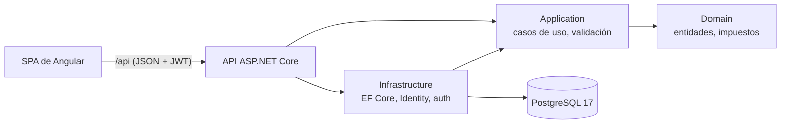

# Ventia

[](https://github.com/yexg08/Ventia/actions/workflows/ci.yml)
[](LICENSE)


**[English](README.md)** · Español

**Punto de venta, inventario y reportes para negocios de comida rápida.** Ventia es multi-negocio: cada negocio tiene
su propio panel (dueño y cajeros) y sus datos quedan completamente aislados de los demás.

> **Es una demo de AndesAiSolutions.** Los comprobantes no tienen validez fiscal ante la DIAN (no hay facturación
> electrónica, nómina electrónica ni documentos soporte) y no se procesan pagos reales: efectivo, tarjeta y
> transferencia solo se registran.

## Capturas

| | |
|---|---|
|  |  |
| **Vender**: menú por categorías, tipo de pedido, notas, adiciones y descuentos | **Comprobante** imprimible con el INC desglosado |
|  |  |
| **Reportes**: utilidad real, ventas por día y horas pico | **Cierre de caja** con el efectivo esperado y la diferencia |
|  |  |
| **Compra a crédito** con sus abonos | **Página de inicio**, en tema claro y oscuro |

## Lo más interesante

- **Aislamiento entre negocios en tres barreras**, cada una con pruebas que fallan si se quita.
- **El servidor manda en cada venta:** el navegador solo envía qué productos y cuántos. Precios, impuestos, descuentos
  y totales los calcula el servidor.
- **Nada se rompe con peticiones simultáneas,** y cada caso tiene una prueba que lanza las peticiones a la vez:
  - el stock nunca queda negativo;
  - los consecutivos no tienen saltos ni repetidos;
  - un doble clic al cobrar crea una sola venta;
  - una cotización se convierte en venta una sola vez;
  - los abonos a un proveedor nunca superan el saldo.

  Todo se resuelve con `UPDATE` condicionales e índices únicos en PostgreSQL, no con chequeos en memoria.
- **Utilidad real:** el costo promedio se congela en cada venta, así una compra posterior no cambia la utilidad de
  ventas pasadas.
- **Un cajero no ve costos ni márgenes:** el servidor no los envía, no basta con ocultar la columna.
- **Pruebas contra un PostgreSQL real** (Testcontainers), más pruebas de mutación: se quita una protección a propósito
  para comprobar que alguna prueba falla.

## Probarlo con Docker

Solo necesitas [Docker Desktop](https://www.docker.com/products/docker-desktop/). Un comando levanta la base de datos,
la API y el frontend, sin instalar .NET ni Node.

```bash
# 1. crea tu archivo .env con claves aleatorias (no se sube a Git)
cat > .env <<EOF
JWT_KEY=$(openssl rand -hex 32)
SUPERADMIN_PASSWORD=Admin1$(openssl rand -hex 6)
DEMO_DATA=true
DEMO_PASSWORD=Demo1$(openssl rand -hex 6)
EOF

# 2. construye y arranca todo
docker compose --profile app up --build
```

<details>
<summary>En PowerShell (Windows) el paso 1 es así</summary>

```powershell
function New-Secret { $b = New-Object byte[] 32; [Security.Cryptography.RandomNumberGenerator]::Create().GetBytes($b); -join ($b | ForEach-Object { $_.ToString('x2') }) }
@"
JWT_KEY=$(New-Secret)
SUPERADMIN_PASSWORD=Admin1$((New-Secret).Substring(0, 12))
DEMO_DATA=true
DEMO_PASSWORD=Demo1$((New-Secret).Substring(0, 12))
"@ | Set-Content .env -Encoding ascii
```

</details>

Abre http://localhost:8081 (usa Chrome, Edge o Firefox: Safari no guarda cookies `Secure` por http). Las contraseñas
están en tu `.env`.

Con `DEMO_DATA=true` se carga **Hamburguesas La Cumbre**, una hamburguesería de Manizales con 30 días de historia:
- unas 700 ventas;
- compras semanales de bebidas, dos de ellas a crédito;
- gastos del mes y cierres de caja;
- tres cotizaciones.

Las fechas se calculan desde hoy, así que los reportes nunca salen vacíos, y el dueño encuentra su caja abierta para
vender de una vez.

| Cuenta | Correo | Contraseña |
|---|---|---|
| Dueño | `dueno@ventia.demo` | `DEMO_PASSWORD` |
| Cajera | `cajera@ventia.demo` | `DEMO_PASSWORD` |
| Superadmin de la plataforma | `admin@ventia.local` | `SUPERADMIN_PASSWORD` |

Para empezar de cero: `docker compose --profile app down -v`.

## Stack

| Capa | Tecnología |
|---|---|
| Backend | .NET 10, ASP.NET Core, EF Core 10, ASP.NET Identity, FluentValidation |
| Base de datos | PostgreSQL 17 |
| Frontend | Angular 22 (zoneless, standalone, signals, `httpResource`), Tailwind CSS v4, Angular CDK, Heroicons |
| Pruebas | xUnit + `WebApplicationFactory` + **Testcontainers** (PostgreSQL real) · Vitest |
| Infraestructura | Docker (imagen única: la API sirve el frontend compilado) · GitHub Actions · Dependabot |



Las dependencias apuntan hacia adentro:
- `Domain` no conoce a nadie.
- `Application` solo conoce `Domain` y habla con el exterior por interfaces como `IAppDbContext`.
- `Infrastructure` implementa esas interfaces.
- `Api` conecta todo.

## Estado

| Fase | Contenido | Estado |
|---|---|---|
| 1 | Base: registro de negocios, login, roles dueño y cajero, cuentas de cajeros, configuración, categorías, superadmin, Docker y CI | Hecha |
| 2 | Catálogo e inventario: productos, movimientos de stock, stock que nunca queda negativo | Hecha |
| 3 | Clientes y proveedores (NIT con dígito de verificación) | Hecha |
| 4 | Punto de venta: carrito, descuentos, pago mixto, consecutivo, anulación, caja, tipo de pedido, notas y adiciones | Hecha |
| 5 | Compras con costo promedio y cotizaciones que se convierten en venta | Hecha |
| 6 | Gastos, salidas de caja y cuentas por pagar | Hecha |
| 7 | Reportes y exportación a CSV | Hecha |
| 8 | Pulido: datos de ejemplo, README bilingüe, capturas | Hecha |
| 9 | Diseño final: moderno, minimalista y con animaciones suaves | Siguiente |

## Funciones

### Multi-negocio y roles

- **Aislamiento en tres barreras:**
  - El negocio de la sesión sale de la base de datos en cada petición (`SessionValidator`), nunca del token ni del cliente.
  - Un filtro global de EF Core limita toda entidad `ITenantOwned` al negocio de la sesión. Pedir por id un dato de otro negocio da 404.
  - Un interceptor de escritura rechaza crear, modificar o borrar datos de otro negocio.
- **Roles:**
  - **Dueño:** administra todo su negocio.
  - **Cajero:** vende, registra clientes y saca efectivo de su caja. No ve costos, compras, reportes ni la configuración.
  - **Superadmin:** ve todos los negocios y puede suspenderlos.
- **Cuentas de cajeros:**
  - El dueño las crea con una contraseña temporal que se ve una sola vez y vence a los 7 días.
  - En el primer ingreso es obligatorio cambiarla, y eso lo aplica la API, no solo la pantalla.
  - Si el dueño genera otra contraseña o desactiva la cuenta, las sesiones del cajero se cortan al instante.
- **Configuración del negocio:** NIT validado con el algoritmo de la DIAN (en el backend y en el navegador), dirección,
  zona horaria, pie del comprobante e impuesto por defecto: INC 8 % (comidas rápidas), IVA 19 %, IVA 5 % o sin impuesto.

### Catálogo e inventario

- Precio con el impuesto incluido. La base y el impuesto se separan con una sola regla de redondeo, y base más impuesto siempre da el precio cobrado.
- Cada producto decide si lleva inventario: una gaseosa sí, una hamburguesa preparada no.
- Entradas, salidas y conteos físicos con motivo. Cada cambio queda como movimiento, con quién lo hizo y el stock que quedó.
- **El stock nunca queda negativo, ni con salidas simultáneas:** el descuento es un solo `UPDATE` con la condición
  adentro (una prueba lanza 8 salidas a la vez sobre un stock de 5 y solo entran 5), y una restricción `CHECK` es la
  última barrera.
- Un producto con movimientos o una categoría con productos no se borran, solo se desactivan.

### Clientes y proveedores

- Documento (cédula, cédula de extranjería, NIT o pasaporte) validado igual en el backend y en el navegador. El NIT se valida con su dígito de verificación.
- **Ley 1581:** la autorización de datos es obligatoria para las personas y queda la fecha. Un cliente puede pedir que
  se borren sus datos: si ya tiene ventas, se **anonimiza** (también en los comprobantes) en vez de borrarse.

### Punto de venta

- **Turnos de caja:** cada cuenta abre su caja con una base y la cierra contando el efectivo. El sistema calcula lo
  esperado (base, más el efectivo de las ventas no anuladas, menos las salidas de caja) y la diferencia.
- **Pantalla de venta:** productos por categoría, buscador que acepta código de barras con Enter, tipo de pedido
  (mesa, para llevar o domicilio), cliente o consumidor final, notas por línea ("sin cebolla"), descuentos y adiciones
  colgadas de un producto.
- **Cobro** en efectivo, tarjeta, transferencia o mixto, con el cambio calculado.
- **Todo o nada:** la venta, sus pagos y el descuento de inventario van en una sola transacción.
- **Consecutivo sin saltos ni repetidos:** el número se toma dentro de la transacción, bloqueando la fila del negocio.
  Una prueba lanza 10 ventas a la vez y reciben del 1 al 10.
- **Un cobro, una venta:** cada cobro lleva una clave de idempotencia. Cinco reintentos simultáneos con la misma clave
  devuelven la misma venta.
- **Comprobante imprimible** con la leyenda "sin validez fiscal" y los impuestos agrupados.
- **Anulación** solo del dueño, con motivo. Devuelve exactamente lo que la venta descontó del inventario.

### Compras, cotizaciones y gastos

- **Compras a proveedores:** suben el stock y recalculan el **costo promedio ponderado** en un solo `UPDATE`, dentro de
  la misma transacción. Pueden ser de contado (incluso con efectivo de la caja) o a crédito.
- **Cuentas por pagar** agrupadas por proveedor, con los días que lleva abierta cada una. **Los abonos nunca superan el
  saldo, ni con pagos simultáneos** (una prueba lanza 5 abonos del 40 % a la vez y solo entran 2).
- **Cotizaciones** con los precios congelados mientras estén vigentes. **Se convierten en venta una sola vez**, aunque
  lleguen cinco conversiones a la vez.
- **Gastos** por categoría (arriendo, servicios, nómina…). Un gasto en efectivo puede salir de la caja abierta: se resta
  del efectivo esperado, y si se anula vuelve a contar.

### Reportes y exportación (solo el dueño)

- Total vendido frente al periodo anterior, número de ventas, ticket promedio, ventas por día y horas pico.
- **Utilidad:** ventas sin impuestos − costo de lo vendido = utilidad bruta − gastos = utilidad neta. Las compras no se
  restan, porque entran al inventario y cuentan como costo cuando se venden.
- Productos más vendidos con su utilidad, medios de pago, tipo de pedido, impuestos cobrados (INC e IVA), vendedores,
  diferencias de caja por cajero, gastos por categoría y valor del inventario.
- **CSV** de ventas, productos vendidos, gastos, compras e inventario, listos para abrir con doble clic en Excel en
  español (punto y coma, coma decimal y UTF-8 con BOM).
- **Protegidos contra inyección de fórmulas:** un texto que empiece por `=`, `+`, `-` o `@` se exporta como texto, para que
  Excel no lo ejecute.

### Seguridad

- Denegar por defecto, con una prueba que recorre todos los endpoints con cada rol.
- Bloqueo tras 5 intentos fallidos y límite de peticiones en login y registro.
- Mismo mensaje para un correo inexistente que para una contraseña incorrecta.
- JWT de 15 minutos en memoria y refresh token rotado en una cookie `httpOnly`, `Secure` y `SameSite=Strict`.
- Cabeceras de seguridad, con una política de contenido que en el frontend autoriza solo sus propios scripts por hash.

## Desarrollo local

Requisitos: [.NET 10 SDK](https://dotnet.microsoft.com/download), [Node.js](https://nodejs.org/) 24+ y
[Docker Desktop](https://www.docker.com/products/docker-desktop/).

```bash
# 1. base de datos (PostgreSQL en el puerto 5435)
docker compose up -d

# 2. secretos de la API (sin la clave JWT la API no arranca)
cd backend/src/Ventia.Api
dotnet user-secrets set "Jwt:Key" "<texto aleatorio de 32 caracteres o más>"
dotnet user-secrets set "Seed:SuperAdminPassword" "<mínimo 10 caracteres, con letras y números>"
# opcional: el negocio de ejemplo
dotnet user-secrets set "Seed:DemoData" "true"
dotnet user-secrets set "Seed:DemoPassword" "<mínimo 10 caracteres, con letras y números>"

# 3. API (http://localhost:5180), aplica las migraciones y carga los datos de ejemplo al arrancar
dotnet run

# 4. en otra terminal: frontend (http://localhost:4380)
cd frontend
npm install
npm start
```

## Pruebas

```bash
# backend (necesita Docker encendido: Testcontainers levanta un PostgreSQL desechable)
cd backend
dotnet test

# frontend
cd frontend
npx ng test --watch=false
```

152 pruebas de backend y 45 de frontend. GitHub Actions corre en cada push:
- compilación y pruebas del backend y del frontend;
- auditoría de dependencias de NuGet y npm;
- construcción de la imagen de Docker, con una prueba de humo: registro, login del superadmin y cabeceras de seguridad.

## Estructura

```
backend/
  src/
    Ventia.Domain/          Entidades (ventas, compras, cotizaciones, gastos…), impuestos e ITenantOwned
    Ventia.Application/     Casos de uso por módulo, DTOs, validaciones, NIT y documentos, CSV
    Ventia.Infrastructure/  EF Core + Identity, filtro e interceptor de negocio, auth, migraciones, datos de ejemplo
    Ventia.Api/             Controladores, políticas, validación de sesión, cabeceras, límites, frontend compilado
  tests/Ventia.Tests/       Integración contra PostgreSQL real + unitarias
frontend/
  src/app/
    core/                   Sesión, interceptores, guards, tema, avisos
    shared/                 Formatos, impuestos, carrito, NIT y documentos, diálogos comunes, descargas
    features/               landing, auth, app (vender, ventas, productos, compras, gastos, reportes…), admin
docs/screenshots/           Capturas del README
```

## Licencia

[MIT](LICENSE)
