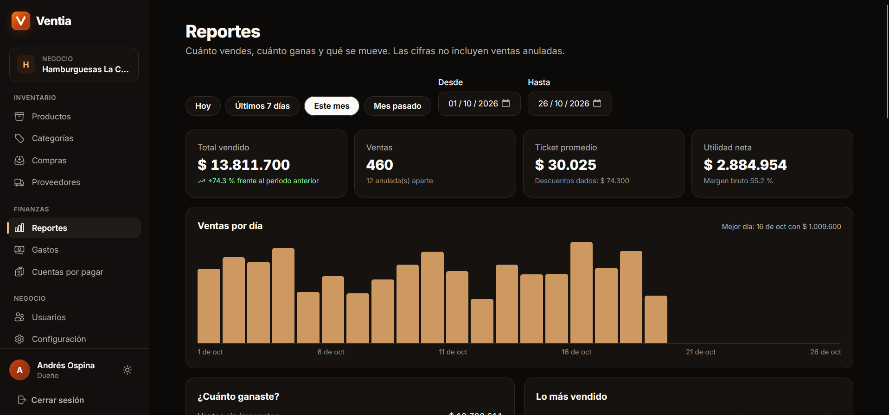
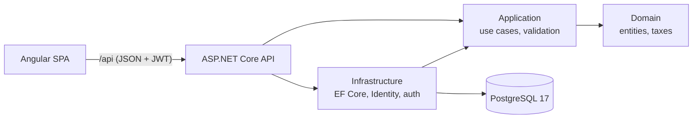

# Ventia

[](https://github.com/yexg08/Ventia/actions/workflows/ci.yml)
[](LICENSE)


English · **[Español](README.es.md)**

**Point of sale, inventory and reports for fast-food businesses.** Ventia is multi-tenant: every business gets its own
dashboard (owner and cashiers), and its data is completely isolated from every other business.

> **A demo by AndesAiSolutions.** The UI is in Spanish (Colombia). Receipts have no tax validity before the DIAN, the
> Colombian tax authority: there is no electronic invoicing, electronic payroll or supporting documents. No real
> payments are processed: cash, card and bank transfer are only recorded.

## Screenshots

| | |
|---|---|
|  |  |
| **Point of sale**: menu by category, order type, notes, add-ons and discounts | **Printable receipt** with the consumption tax broken down |
|  |  |
| **Reports**: real profit, sales by day and peak hours | **Closing the register**, with expected cash and the difference |
|  |  |
| **Purchase on credit** with its partial payments | **Landing page**, light and dark themes |

## What is interesting about it

- **Tenant isolation enforced in three layers**, with tests that fail if any of them is removed.
- **The server owns every sale:** the browser only sends which products and how many. Prices, taxes, discounts and
  totals are computed on the server.
- **Nothing breaks under concurrent requests,** and each case has a test that fires the requests at the same time:
  - stock never goes negative;
  - document numbers have no gaps or duplicates;
  - a double click on "charge" creates a single sale;
  - a quote becomes a sale only once;
  - payments to a supplier never exceed the balance.

  All of it is solved with conditional `UPDATE`s and unique indexes in PostgreSQL, not with in-memory checks.
- **Real profit:** the average cost is frozen on every sale, so a later purchase does not change the profit of past
  sales.
- **Cashiers never see costs or margins:** the server does not send them. Hiding the column is not enough.
- **Tests against a real PostgreSQL** (Testcontainers), plus mutation testing: a protection is removed on purpose to
  confirm that some test fails.

## Try it with Docker

You only need [Docker Desktop](https://www.docker.com/products/docker-desktop/). One command starts the database, the
API and the frontend, with no .NET or Node installed.

```bash
# 1. Create your .env file with random secrets (it is not committed)
cat > .env <<EOF
JWT_KEY=$(openssl rand -hex 32)
SUPERADMIN_PASSWORD=Admin1$(openssl rand -hex 6)
DEMO_DATA=true
DEMO_PASSWORD=Demo1$(openssl rand -hex 6)
EOF

# 2. Build and start everything
docker compose --profile app up --build
```

<details>
<summary>On PowerShell (Windows), step 1 looks like this</summary>

```powershell
function New-Secret { $b = New-Object byte[] 32; [Security.Cryptography.RandomNumberGenerator]::Create().GetBytes($b); -join ($b | ForEach-Object { $_.ToString('x2') }) }
@"
JWT_KEY=$(New-Secret)
SUPERADMIN_PASSWORD=Admin1$((New-Secret).Substring(0, 12))
DEMO_DATA=true
DEMO_PASSWORD=Demo1$((New-Secret).Substring(0, 12))
"@ | Set-Content .env -Encoding ascii
```

</details>

Open http://localhost:8081. Use Chrome, Edge or Firefox: Safari does not store `Secure` cookies over http. The
passwords are in your `.env` file.

With `DEMO_DATA=true`, **Hamburguesas La Cumbre** is loaded: a burger place in Manizales with 30 days of history.
- about 700 sales;
- weekly drink purchases, two of them on credit;
- the month's expenses and register closings;
- three quotes.

Dates are computed from today, so the reports are never empty, and the owner finds the register already open, ready to
sell.

| Account | Email | Password |
|---|---|---|
| Owner | `dueno@ventia.demo` | `DEMO_PASSWORD` |
| Cashier | `cajera@ventia.demo` | `DEMO_PASSWORD` |
| Platform superadmin | `admin@ventia.local` | `SUPERADMIN_PASSWORD` |

To start over: `docker compose --profile app down -v`.

## Stack

| Layer | Technology |
|---|---|
| Backend | .NET 10, ASP.NET Core, EF Core 10, ASP.NET Identity, FluentValidation |
| Database | PostgreSQL 17 |
| Frontend | Angular 22 (zoneless, standalone, signals, `httpResource`), Tailwind CSS v4, Angular CDK, Heroicons |
| Tests | xUnit + `WebApplicationFactory` + **Testcontainers** (real PostgreSQL) · Vitest |
| Infrastructure | Docker (single image: the API serves the compiled frontend) · GitHub Actions · Dependabot |



Dependencies point inward:
- `Domain` knows nothing.
- `Application` only knows `Domain`, and talks to the outside through interfaces such as `IAppDbContext`.
- `Infrastructure` implements those interfaces.
- `Api` wires everything together.

## Status

| Phase | Content | Status |
|---|---|---|
| 1 | Foundation: business sign-up, login, owner and cashier roles, cashier accounts, settings, categories, superadmin, Docker and CI | Done |
| 2 | Catalog and inventory: products, stock movements, stock that never goes negative | Done |
| 3 | Customers and suppliers (Colombian tax ID with check digit) | Done |
| 4 | Point of sale: cart, discounts, split payments, document numbers, voiding, register shifts, order types, notes and add-ons | Done |
| 5 | Purchases with average cost, and quotes that become sales | Done |
| 6 | Expenses, cash taken from the register, and accounts payable | Done |
| 7 | Reports and CSV export | Done |
| 8 | Polish: sample data, bilingual README, screenshots | Done |
| 9 | Final design: modern, minimal, with smooth animations | Done |

## Features

### Multi-tenancy and roles

- **Isolation in three barriers:**
  - The session's business is read from the database on every request (`SessionValidator`), never from the token or
    the client.
  - An EF Core global query filter limits every `ITenantOwned` entity to the session's business. Asking for another
    business's record by id returns 404.
  - A write interceptor rejects creating, changing or deleting another business's data.
- **Roles:**
  - **Owner:** manages the whole business.
  - **Cashier:** sells, registers customers and takes cash out of their own register. Cannot see costs, purchases,
    reports or settings.
  - **Superadmin:** sees every business and can suspend them.
- **Cashier accounts:**
  - The owner creates them with a temporary password that is shown once and expires after 7 days.
  - Changing it on first login is mandatory, enforced by the API and not only by the UI.
  - If the owner resets the password or deactivates the account, the cashier's sessions end immediately.
- **Business settings:**
  - Tax ID validated with the DIAN algorithm, both on the backend and in the browser.
  - Address, time zone and receipt footer.
  - Default tax: 8 % consumption tax (fast food), 19 % VAT, 5 % VAT, or none.

### Catalog and inventory

- Prices include tax. The base and the tax are split with a single rounding rule, and base plus tax always equals the
  price charged.
- Each product decides whether it tracks stock: a soda does, a freshly made burger does not.
- Stock in, stock out and physical counts, each with a reason. Every change is a movement recording who made it and the
  resulting stock.
- **Stock never goes negative, even with concurrent sales.** Each decrement is a single `UPDATE` with the condition
  inside; a test fires 8 withdrawals at once against a stock of 5, and only 5 succeed. A `CHECK` constraint is the last
  barrier.
- A product with movements, or a category with products, is never deleted, only deactivated.

### Customers and suppliers

- ID documents (national ID, foreign ID, tax ID or passport) are validated the same way on the backend and in the
  browser. Tax IDs are checked with their verification digit.
- **Colombian data protection law (Ley 1581):**
  - Consent to process personal data is mandatory for individuals, and its date is stored.
  - A customer can ask to have their data deleted. If they already have sales, they are **anonymized**, receipts
    included, instead of deleted.

### Point of sale

- **Register shifts:** each account opens its register with a starting float and closes it by counting the cash. The
  system computes the expected amount and the difference: the float, plus cash from sales that were not voided, minus
  cash taken out.
- **Sales screen:**
  - products by category, and a search box that accepts a barcode scanner with Enter;
  - order type: dine-in, take-away or delivery;
  - a registered customer, or an anonymous one;
  - per-line notes ("no onion"), discounts, and add-ons attached to a product.
- **Payment** in cash, card, bank transfer or a mix, with the change computed.
- **All or nothing:** the sale, its payments and the stock decrement run in a single transaction.
- **Gap-free document numbers:** the number is taken inside the transaction, locking the business row. A test fires 10
  sales at once, and they get numbers 1 to 10.
- **One charge, one sale:** every charge carries an idempotency key. Five simultaneous retries with the same key return
  the same sale.
- **Printable receipt** stating "no tax validity", with taxes grouped.
- **Voiding** is owner-only and requires a reason. It returns exactly what the sale took from stock.

### Purchases, quotes and expenses

- **Purchases from suppliers** increase stock and recompute the **weighted average cost** in a single `UPDATE`, inside
  the same transaction. They can be paid on the spot (even with cash from the register) or on credit.
- **Accounts payable**, grouped by supplier, showing how many days each one has been open.
- **Partial payments never exceed the balance, even when they arrive at the same time.** A test fires five 40 %
  payments at once, and only 2 succeed.
- **Quotes** keep their prices frozen while they are valid. **A quote becomes a sale only once**, even with five
  simultaneous conversions.
- **Expenses** by category: rent, utilities, payroll and so on.
  - A cash expense can come out of the open register. It is subtracted from the expected cash.
  - Voiding the expense makes the cash count again.

### Reports and export (owner only)

- Total sold compared with the previous period, number of sales, average ticket, sales by day, and peak hours.
- **Profit:** net sales (without tax) − cost of goods sold = gross profit − expenses = net profit. Purchases are not
  subtracted: they become inventory and count as cost when sold.
- **Breakdowns:**
  - top products with their profit;
  - payment methods and order types;
  - taxes collected;
  - sellers, and register differences per cashier;
  - expenses by category, and inventory value.
- **CSV export** of sales, sold products, expenses, purchases and inventory.
  - The files open with a double click in Spanish-locale Excel: semicolon separator, decimal comma, and UTF-8 with BOM.
  - **Protected against formula injection:** text starting with `=`, `+`, `-` or `@` is exported as plain text, so Excel
    never runs it.

### Design

- Minimal and warm, with the brand orange as the only accent color. Light and dark themes, with contrast checked
  against WCAG AA using the luminance formula.
- **Smooth animations, CSS only:**
  - page changes use the View Transitions API;
  - the theme switch is a circle that grows from the button;
  - dialogs and toasts slide in, lists cascade, chart bars grow, and loading placeholders shimmer.
- **Accessible motion:** everything turns off for people who ask their system for reduced motion.

### Security

- Deny by default, with a test that walks every endpoint with every role.
- Lockout after 5 failed attempts, and rate limiting on login and sign-up.
- The same message for an unknown email as for a wrong password.
- 15-minute JWT kept in memory, and a rotating refresh token in an `httpOnly`, `Secure`, `SameSite=Strict` cookie.
- Security headers, with a Content Security Policy that only allows the frontend's own scripts, by hash.

## Local development

Requirements: [.NET 10 SDK](https://dotnet.microsoft.com/download), [Node.js](https://nodejs.org/) 24+ and
[Docker Desktop](https://www.docker.com/products/docker-desktop/).

```bash
# 1. Database (PostgreSQL on port 5435)
docker compose up -d

# 2. API secrets (the API does not start without the JWT key)
cd backend/src/Ventia.Api
dotnet user-secrets set "Jwt:Key" "<random text, 32+ characters>"
dotnet user-secrets set "Seed:SuperAdminPassword" "<10+ characters, letters and numbers>"
# optional: the sample business
dotnet user-secrets set "Seed:DemoData" "true"
dotnet user-secrets set "Seed:DemoPassword" "<10+ characters, letters and numbers>"

# 3. API (http://localhost:5180): applies migrations and loads the sample data on startup
dotnet run

# 4. In another terminal: frontend (http://localhost:4380)
cd frontend
npm install
npm start
```

## Tests

```bash
# Backend (Docker must be running: Testcontainers starts a throwaway PostgreSQL)
cd backend
dotnet test

# Frontend
cd frontend
npx ng test --watch=false
```

152 backend tests and 45 frontend tests. GitHub Actions runs on every push:
- build and tests for the backend and the frontend;
- NuGet and npm dependency audit;
- Docker image build, with a smoke test: sign-up, superadmin login and security headers.

## Project structure

```
backend/
  src/
    Ventia.Domain/          Entities (sales, purchases, quotes, expenses…), taxes and ITenantOwned
    Ventia.Application/     Use cases per module, DTOs, validation, tax IDs and documents, CSV
    Ventia.Infrastructure/  EF Core + Identity, tenant filter and interceptor, auth, migrations, sample data
    Ventia.Api/             Controllers, policies, session validation, headers, rate limits, compiled frontend
  tests/Ventia.Tests/       Integration tests against real PostgreSQL + unit tests
frontend/
  src/app/
    core/                   Session, interceptors, guards, theme, toasts
    shared/                 Formatting, taxes, cart, tax IDs and documents, shared dialogs, downloads
    features/               landing, auth, app (sell, sales, products, purchases, expenses, reports…), admin
docs/screenshots/           README screenshots
```

## License

[MIT](LICENSE)
